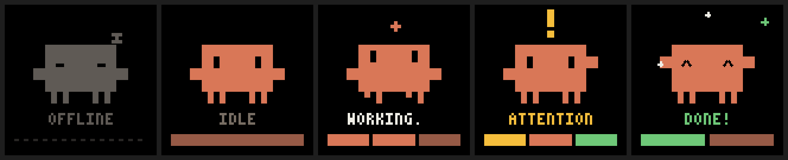

# clawd-tracker

Shows the status of your Claude Code sessions on the screen of the **Attack Shark X820 Ultra**
keyboard (0.85" 128×128 TFT), using an animated Clawd, Claude Code's mascot.



| State | When |
|---|---|
| `OFFLINE` | no Claude Code session open |
| `IDLE` | session open and waiting (or `DONE!` for more than 5 min) |
| `WORKING` | processing a prompt or running tools |
| `ATTENTION` | asking for permission |
| `DONE!` | finished answering |

The bar at the bottom has one segment per session, colored by that session's state, so it grows
with the number of agents. The big animation shows the most urgent state:
attention > working > done > idle.

Works on **Windows** and **Linux** (Ubuntu and others).

## How it works

```
Claude Code ──(HTTP hooks)──▶ clawd-tracker daemon (127.0.0.1:47820) ──(USB HID)──▶ keyboard screen
```

- The hooks are of type `http`. Claude Code itself POSTs each event to the local daemon, so the
  hooks don't depend on Python, shell or OS. If the daemon is not running, Claude Code just carries on.
- The daemon keeps the state of each session and, when something changes, uploads the matching
  animation to the keyboard (3–5 s per change).

## Install

Requires Python 3.9+.

**1. Daemon**

```bash
pipx install git+https://github.com/Guilherme-b-damasio/clawd-tracker
```

(or `pip install git+https://github.com/Guilherme-b-damasio/clawd-tracker`; if the `clawd-tracker`
command is not on your PATH, use `python -m clawd_tracker` instead.)

**2. Linux only: permission to talk to the keyboard without root**

```bash
clawd-tracker udev
```

It prints the two `sudo` commands that install the udev rule (also in `linux/99-clawd-tracker.rules`).
Unplug and plug the keyboard cable afterwards.

**3. Start with the system**

```bash
clawd-tracker autostart
```

- Windows: a script in the Startup folder (runs with `pythonw`, no window).
- Linux: a `systemd --user` service (`journalctl --user -u clawd-tracker -f` for logs).

**4. Connect Claude Code** (either one)

As a plugin, inside Claude Code:

```
/plugin marketplace add Guilherme-b-damasio/clawd-tracker
/plugin install clawd-tracker@clawd-tracker
```

Or by writing the hooks to `~/.claude/settings.json`:

```bash
clawd-tracker hooks
```

**5. Check**

```bash
clawd-tracker status
```

## Requirements and limitations

- The keyboard must be **on the cable, in wired mode**. The firmware refuses image uploads over 2.4G
  (the official app has the same restriction). Over 2.4G the keyboard works normally, only the
  screen doesn't update.
- On Windows, **close the official Attack Shark app**: it talks to the keyboard at the same time and
  corrupts uploads.
- Each change is written to the keyboard's flash memory.

## Commands

```
clawd-tracker run [--dry-run]     run the daemon in the foreground (--dry-run: no keyboard, writes ~/.clawd-tracker/current.gif)
clawd-tracker autostart [--remove]
clawd-tracker hooks [--remove]
clawd-tracker udev
clawd-tracker status
clawd-tracker set <idle|working|attention|done|end> [--session ID]
clawd-tracker preview [dir]       write preview GIFs of the animations
```

## Using it from anything else

Any program can drive the screen through the local HTTP API (only on `127.0.0.1`):

```bash
curl -X POST http://127.0.0.1:47820/state -d '{"session": "my-agent", "state": "working"}'
curl http://127.0.0.1:47820/status
```

`POST /hook` takes the JSON of a Claude Code hook directly (`hook_event_name`, `session_id`, ...).

## Protocol

Extracted from the official driver (Attack Shark Driver v4). Details in
[`src/clawd_tracker/x820.py`](src/clawd_tracker/x820.py):

- 64-byte HID feature reports on the vendor interface (usage page `0xFFFF`, usage `2`), VID `0x3151`,
  PID `0x5002` (wired) / `0x5006` (2.4G receiver).
- Byte 7 is a checksum: `255 - (sum(bytes[0..6]) & 0xFF)`.
- `0xA5`: header (frame, frame count, delay in ms, frame size, rectangle). The keyboard answers with byte 1 = 1 when ready.
- `0x25`: data, 8-byte header + 56 bytes of RGB565 big-endian pixels, scanned column by column.
- Pure black pixels outside the drawing don't need to be sent (the rectangle covers only the rest).
- A ~1 ms pause between packets is needed, otherwise the keyboard drops data and the frames come out corrupted.

## Other files

- `assets/clawd_128.gif`: a 14 s animated Clawd GIF (128×128) to upload with the official app.

Not affiliated with Anthropic or Attack Shark.
